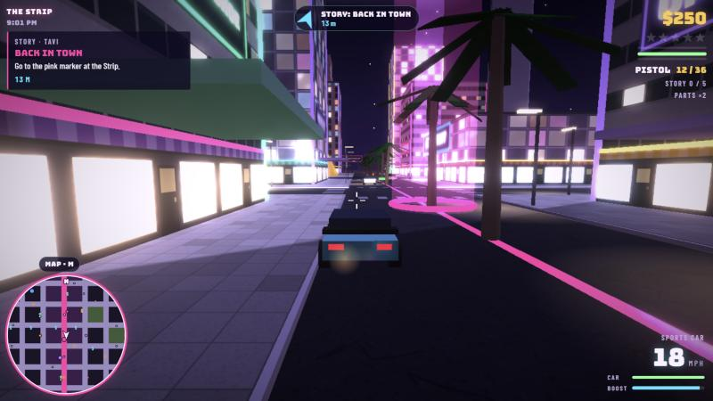
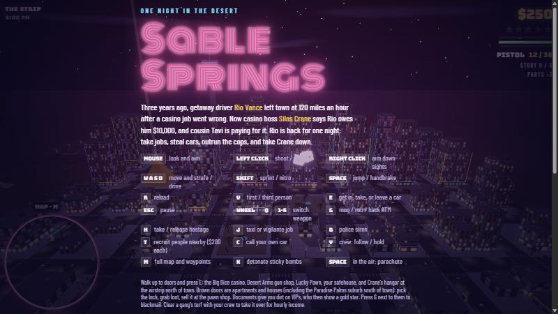
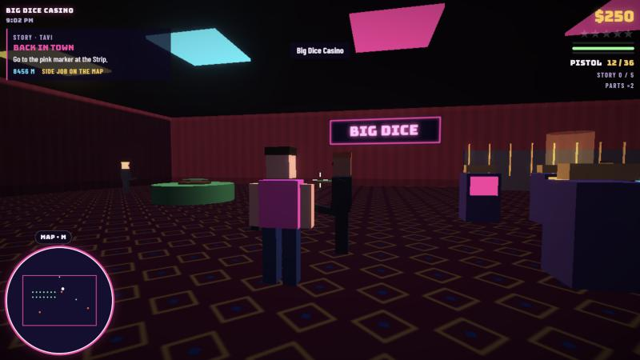
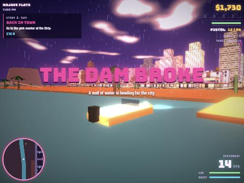
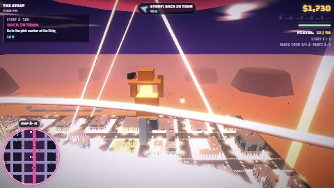
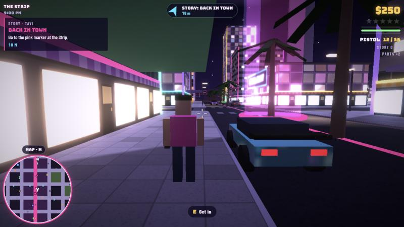
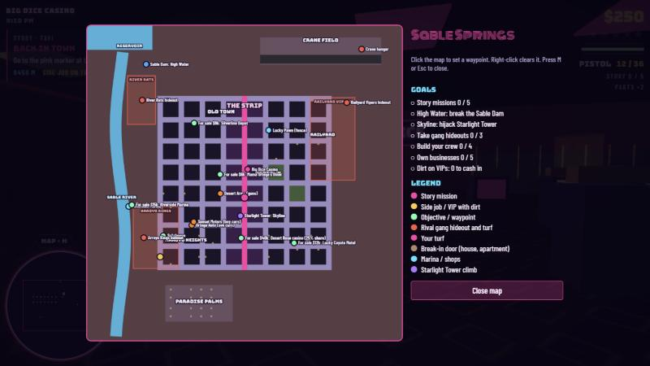

<div align="center">

# 🌵 Sable Springs

**An open-world 3D crime sandbox set in a neon desert casino city. It runs in your browser.**

[**▶ Play in your browser**](https://advaithsajith.github.io/sable-springs/) &nbsp;·&nbsp; [Player guide](#-player-guide) &nbsp;·&nbsp; [Playtest paper](paper/PAPER.md) &nbsp;·&nbsp; [Run it locally](#-run-it-locally)

  



</div>

Drive the Strip at night, rob casinos, build a crew, take over gang turf, climb the tallest tower in town and, if you're feeling bold, blow the dam and flood the whole city. Everything is built from code in one HTML file. There are no downloads or installs.

## 📸 Screenshots

<table>
  <tr>
    <td></td>
    <td></td>
  </tr>
  <tr>
    <td align="center"><sub>The title screen</sub></td>
    <td align="center"><sub>Inside the Big Dice Casino. Many buildings can be entered.</sub></td>
  </tr>
  <tr>
    <td></td>
    <td></td>
  </tr>
  <tr>
    <td align="center"><sub><i>High Water</i>: the dam breaks and the river floods the city</sub></td>
    <td align="center"><sub>Parachuting off Starlight Tower</sub></td>
  </tr>
  <tr>
    <td></td>
    <td></td>
  </tr>
  <tr>
    <td align="center"><sub>On foot on the Strip</sub></td>
    <td align="center"><sub>The map (M) lists every goal and lets you set waypoints</sub></td>
  </tr>
</table>

## 🎮 Player guide

### Your first five minutes

1. **Click Play.** The mouse locks so you can look around. Press **Esc** to get it back.
2. **Follow the arrow at the top of the screen.** It always points to your current goal. The first story mission, *Back in Town*, starts at the pink marker on the Strip.
3. **Grab a car.** Walk up to one and press **E**. Hold **Shift** for nitro.
4. **Step into a marker** and press **E** to start a mission. You can also stop your car inside the marker.
5. **Press M** for the full map. It shows every mission, shop, hideout and property for sale. Click anywhere on it to set a waypoint.

### Controls

| Key | On foot | In a vehicle |
| --- | --- | --- |
| **Mouse** | Look and aim | Look around |
| **W A S D** | Move | Drive |
| **Shift** | Sprint | Nitro |
| **Space** | Jump; open your parachute in the air | Handbrake |
| **Left / right click** | Shoot or punch / aim down sights | |
| **E** | Get in a car, enter a door, start a mission | Get out |
| **R** | Reload | |
| **Wheel, Q, 1-5** | Switch weapon | |
| **V** | Switch between first and third person (pick your default under Settings → View) | Same |
| **M** | Map and waypoints | Same |
| **G** | Mug, rob a store, hack an ATM | |
| **H** | Take or release a hostage | |
| **T** | Recruit nearby people into your crew ($200 each) | |
| **Y** | Crew: follow or hold | |
| **X** | Detonate sticky bombs | |
| **C** | Call your own car | |
| **J** | | Taxi or vigilante job |
| **B** | | Police siren |

The game works on touch screens too, with on-screen buttons.

### Things to do

| | Activity | How |
| --- | --- | --- |
| 📖 | **Story** | Five missions for Tavi, starting with *Back in Town* on the Strip. |
| 🏙️ | **Skyline** | Climb Starlight Tower, take what's at the top, then jump and parachute out. |
| 🌊 | **High Water** | Plant charges on the Sable Dam and flood the city. Speedboats wait at Riverside Marina. |
| 🏴 | **Gangs and turf** | Recruit a crew with **T**, take over rival hideouts near the river, and hold off the waves that come back for them. |
| 🏠 | **Break-ins** | Houses and apartments in the suburbs. Dirt you find on VIPs can be used for blackmail. |
| 💼 | **Side jobs** | Couriers, street races, taxi and vigilante work (**J**). |
| 🚨 | **Street events** | Muggings, ambushes, armored trucks and crashes pop up as you explore. Follow the yellow arrow. |
| 💰 | **Spend it** | Buy businesses that pay you every minute, cars from the dealership, outfits, extended mags, a suppressor and guns for your crew. |
| 🧪 | **Custom mode** | Open it on the start screen. Switch rules on or off, give yourself money or weapons, spawn vehicles, clear your wanted level, and flood or drain the city whenever you want. |

### Tips

- **Gun shops and the pawn shop lock their doors at 3 wanted stars,** so lose the cops before you go shopping.
- **Cops won't shoot while you hold a hostage** (**H**).
- **Headshots do nearly three times the damage.**
- **Gunfire inside a gang zone doesn't bring police,** because the gangs handle their own fights.
- **Missions can be replayed** for 20% of their first payout.
- **Buy a business early.** The income adds up while you play.
- **Lost?** Open the map with **M**. The goals list shows what's left to do.
- Progress saves automatically in your browser.

## 💻 Run it locally

The game loads three.js from a CDN, so you need an internet connection. Serve the folder over HTTP rather than opening the file directly:

```bash
python -m http.server 8000
```

Then open http://localhost:8000.

## 🤖 The playtest study

Before release, scripted bots played the game in 324 sessions across eight play styles: story, side jobs, chaos, burglar, turf, explorer, skyline and flood. They logged every death, arrest, mission, dollar and stuck moment. The data showed where the game was failing players. The fixes made from it:

| Measure | Before | After |
| --- | --- | --- |
| Missions finished per mission started | 13% | 27% |
| Sessions with no reward at all | 61% | 20% |
| Things happening per minute | 3.6 | 5.4 |
| Longest dull stretch for burglars (median) | 276 s | 79 s |
| Crashes | 0 | 0 |

Full write-up: [**paper/PAPER.md**](paper/PAPER.md). Raw numbers: [`results/summary.json`](results/summary.json).

<details>
<summary><b>Running the bots yourself</b></summary>

1. Start a local server in the repository folder (see above).
2. Open http://localhost:8000/playtest/harness.html. It is the same game with `bots.js` added.
3. In the browser console, run:

```js
runAllAsync(200, 5)            // 200 sessions of 5 simulated minutes, all 8 play styles
window.__PROGRESS              // progress
window.__RESULTS               // per-session telemetry when done
```

To run only some play styles, pass a list: `runAllAsync(24, 5, ['story', 'flood'])`. Keep the tab in the foreground, because browsers slow down background tabs.

Each bot drives the real game through a headless simulation step at about 100 times real speed. The bots save progress in that page's browser storage, so use a separate browser profile if you also play the game on the same address.

</details>

## 📁 Repository layout

| Path | What it is |
| --- | --- |
| `index.html` | The whole game, including telemetry hooks and the simulation step the bots use |
| `playtest/harness.html` | The game with the bot script added |
| `playtest/bots.js` | The scripted bot players and the session runner |
| `paper/PAPER.md` | The playtest paper |
| `paper/figures/` | The paper's charts |
| `results/summary.json` | Aggregate results of every run |
| `docs/images/` | Screenshots for this page |

<div align="center"><sub>Sable Springs is an original game and is not affiliated with any other game or studio. Built with <a href="https://threejs.org">three.js</a>.</sub></div>
