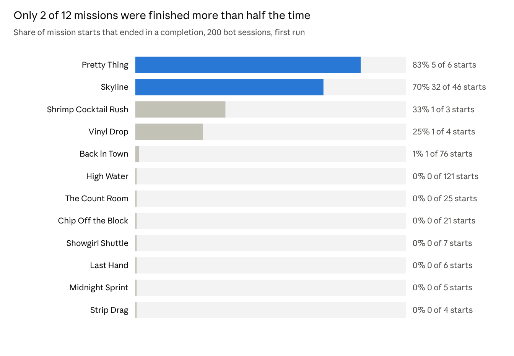
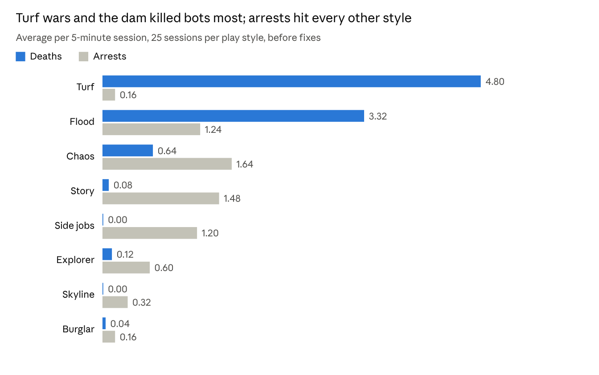
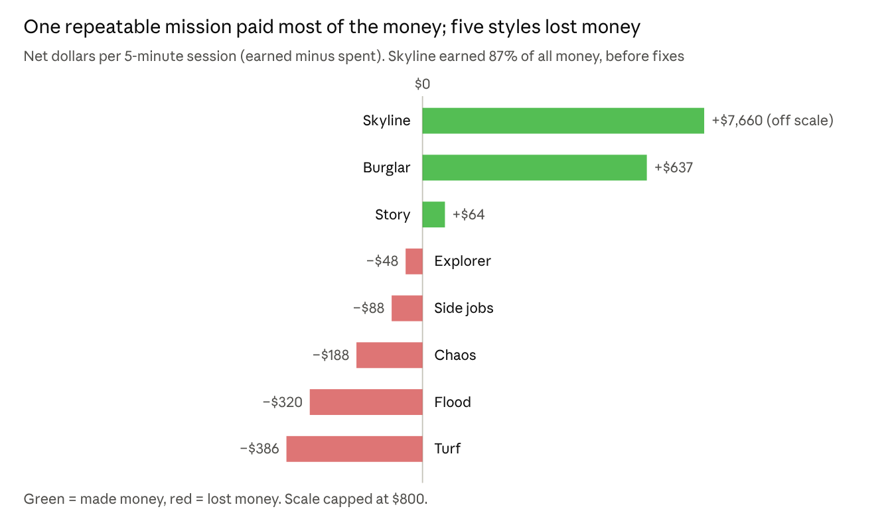
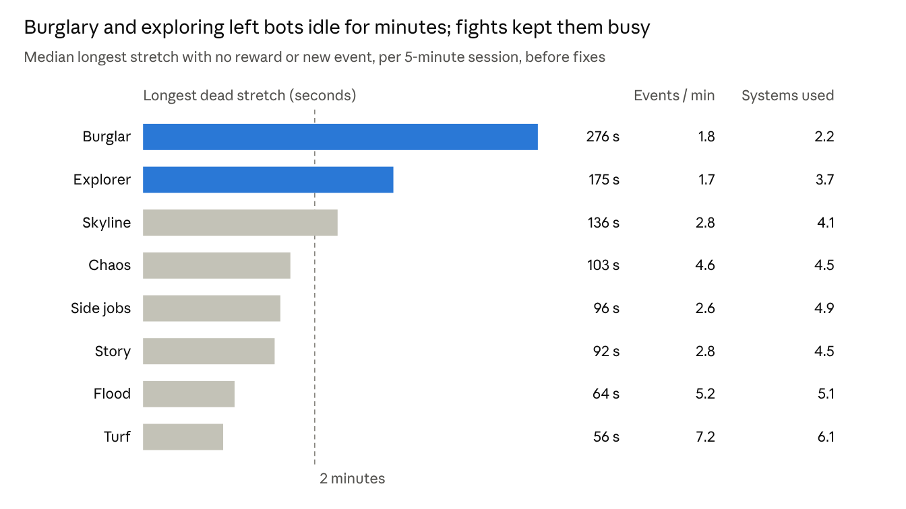
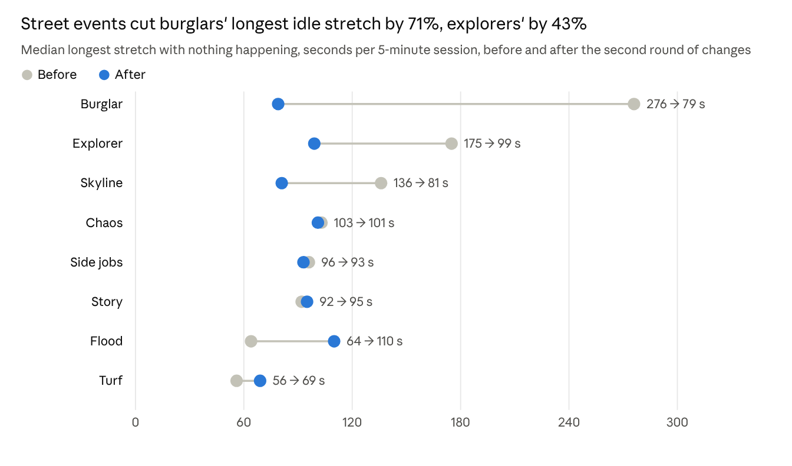

# Playtesting Sable Springs with 200 Simulated Players

November 1, 2026 · Sajith Kumar

**Abstract.** We ran 324 automated play sessions of the browser game Sable Springs: 200 in a first run, then 124 to check fixes. That came to 1,620 simulated minutes across eight player archetypes, with 0 crashes and 0 script errors. The first run found that only 12% of started missions were finished, that one repeatable mission paid 87% of all money, and that 61% of sessions earned nothing in 5 minutes. Turf wars and the dam caused 51% of deaths. We fixed seven issues: silent mission loss, accidental starts, replay pay, tight timers, dam security, gunfire reporting in guarded zones, and turf wave size. We then added street events and things to buy. Afterwards, missions finished per start rose to 22%, sessions without a reward fell to 20%, events per minute rose about 50%, and burglars' longest idle stretch fell 71%. Spending is still out of reach in a short session, and turf remains hard for solo players.

## Introduction

Sable Springs is an original open-world 3D crime sandbox that runs in a web browser. It is set in a fictional neon desert casino city with a river, a suburb and an airstrip. The player can drive 9 vehicle types, fight with 7 weapons, play 5 story missions and 2 special missions, take side jobs, rob and burgle, blackmail VIPs, build a crew and take over gang turf.

The game grew quickly through many feature passes, so most of its systems had never been played end to end. Human playtests are slow and small. This study runs many automated players through the real game code to find out which systems players reach, where they get stuck or die, how money flows, and which loops hold attention.

The simulated players are scripted bots, not language-model agents. A language model cannot steer a real-time 3D game at hundreds of sessions within a reasonable cost, while a scripted bot can run a session in seconds.

## Method

We ran 200 sessions of 5 simulated minutes each, 25 per play style, for 1,000 simulated minutes in total. Each bot plays the unmodified game through a headless simulation step that runs the same update code as the live game, minus rendering, at about 100 times real speed.

**The harness.** The bots press the same keys a person does (W, A, S, D, Shift, Space, E, R, mouse fire) and set the camera's look direction. They navigate with simple feelers: if the straight path is blocked by a building, they try angles either side. They do not use a map or pathfinding, so they are weaker navigators than people.

**Eight play styles**, each a different reason to play:

| Play style | What the bot tries to do |
| --- | --- |
| Story | Follows story missions from a random starting point (missions 1 to 5) |
| Side jobs | Takes gold side jobs: courier runs, getaways, ransoms, races |
| Chaos | Drives around, then shoots and throws grenades at bystanders |
| Burglar | Picks apartment and house locks, loots, sells at the pawn shop |
| Turf | Recruits a crew, then attacks rival gang hideouts |
| Explorer | Drives to random points across the whole map |
| Skyline | Plays the Starlight Tower climb, hack and parachute mission |
| Flood | Plays the High Water dam-break mission |

**Each session** starts at the spawn point with $800, a pistol, and no wanted level. Combat styles also start with an SMG and 4 grenades. Bots fight back when gang members, angry citizens or residents turn hostile.

**Telemetry.** The game logs deaths, arrests, mission starts, completions and failures (with reason), money in and out, wanted-level gains, vehicles entered, people downed, buildings entered, loot taken, turf wars, recruiting and blackmail. The harness adds distance on foot and by vehicle, time in vehicles, shots fired, and stuck events (wanting to move but covering less than 1.5 m in 6 seconds) with their positions.

**Engagement proxies.** Bots do not feel anything, so we use proxies a designer can act on: time to first reward, events per minute, the longest stretch with nothing happening (dead time), how many different systems a session touched, and frustration signals (deaths, arrests, failures, getting stuck).

## Results: progression

Bots started 328 missions and finished 40, a 12% completion rate. Two missions carried almost all of it: Skyline (32 of 46) and Pretty Thing (5 of 6). Ten of the twelve missions bots tried were finished a quarter of the time or less.

Three patterns explain most of the gap:

- **Accidental starts.** Back in Town was started 76 times but finished once. Its marker sits 12 m from the spawn point, so bots of every style walked into it and started it without meaning to. That locked them out of their own mission until the timer ran out.
- **Tight timers.** Every failure in the logs was "Out of time". Chip Off the Block failed 16 of 21 tries on its 55-second limit, and both street races failed every attempt.
- **Missions that vanish.** High Water was started 121 times with no completions and no logged failures. Dying cancelled the mission with no message, and bots walked back and restarted it, about 5 times per session.

## Results: difficulty

Bots died 225 times and were arrested 170 times in 1,000 simulated minutes, about one setback every 2.5 minutes. The danger was concentrated in two places.

- **Turf wars** cost 4.8 deaths per session. All 8 defenders turned hostile at once, and solo bots rarely hired a crew first, so they kept dying and restarting the war (5.1 wars per session, 1 turf taken in 25 sessions). Deaths clustered at the Arroyo Kings hideout (52 of 225).
- **The dam** cost 3.3 deaths per High Water session. Stroud Water security shot on sight before the mission had even asked the player to approach. 62 of 225 deaths happened around the dam.
- **Arrests** came mostly from missions that add stars (The Count Room adds 3) and from chaos play. Wanted levels peaked at 3.5 stars on average for chaos bots.

## Results: economy

Bots earned $220,970 in total, and 87% of it came from one mission. Skyline paid its full $6,000 every time it was replayed, so skyline bots finished it 1.3 times per session and averaged +$7,660. Five of eight play styles lost money.

- **Burglary was the only steady earner** besides Skyline, at about $660 per session from apartment loot and the pawn shop.
- **Losses came from fines.** Hospital bills, arrest fines and recruiting costs outweighed what turf, flood, chaos and side-job bots earned.
- **Side jobs barely paid** because few were finished in time (2 of 25 side-job bots completed one).

## Results: navigation

Bots logged 1,907 stuck events, about 1.9 per simulated minute. We checked every one of the 37 doors and found none placed inside a wall. Most stuck events come from the bots' simple steering, but where they cluster still shows where the city is hard to move through.

| Area (60 m cell) | Stuck events | Mostly |
| --- | --- | --- |
| East residential blocks near (180, 120) | 68 | On foot, reaching an apartment door behind a building |
| Spawn and the Strip, (0, 0) | 93 | On foot and in cars, dense casinos, canopies and traffic |
| Midtown, (0, 60) | 37 | On foot |
| Old Town and Westside, (-60, -60) to (-60, 0) | 87 | On foot and in cars |

- **Burglars got stuck most** (22 per session) because apartment doors sit on sidewalks between buildings, and the straight-line path to them runs into walls.
- **Explorers** (14.5 per session) got stuck at the city edge, where roads end in desert with palms and cacti.
- **Cars got stuck less than walkers.** The road grid is open, while the sidewalks and lots between buildings are a maze for anything without a map.
- **Bots had to be teleported free** 0.08 to 0.68 times per session, most often on the Starlight Tower deck and around the dam.

People read the minimap and the objective arrow, so they will get stuck far less. The hotspots are still the right places to check for tight gaps and missing walkways.

## Engagement analysis

Combat loops held simulated players best and solitary loops held them worst. Turf bots saw 7.2 events per minute and never went more than about a minute without something happening. Burglars and explorers went 3 to 4.5 minutes without a reward or a new event.

- **Fights are dense but punishing.** Turf and flood sessions touched the most systems (6.1 and 5.1) and had the shortest dead stretches, but they were also where bots died most. They are exciting, and as tuned they were also frustrating.
- **Burglary pays but drags.** Most of a burglar's 5 minutes went on walking between doors. 18 of 25 burglars earned nothing, while the rest earned well, so the loop rewards players who already know where the doors are.
- **Exploring is empty between landmarks.** Explorers crossed the map but rarely found anything to do on the way: median first reward at 206 seconds, the slowest of any style.
- **First reward comes late.** Across styles, the median first payout arrived 70 to 117 seconds in, and 122 of 200 sessions earned nothing at all in 5 minutes. A new player's first two minutes are mostly travel.

These are proxies: a human may enjoy a quiet drive. They mark where to check with real players first.

## Bugs and issues found, and what we fixed

The 200 sessions ran 1,000 simulated minutes with **0 crashes and 0 script errors**. Every problem found was a design or balance issue, not broken code. We fixed seven and re-ran 60 sessions on the patched game.

| Issue found | Evidence | Fix | After the fix |
| --- | --- | --- | --- |
| Missions vanished silently when you died or were arrested | High Water: 121 starts, 0 completions, 0 logged failures | Death and arrest now end the mission with "Mission failed" | Failures are logged and shown (20 of 24 High Water ends now say why) |
| Walking past a marker started a mission | Back in Town started 76 times, often by bots that were not trying to | On foot, markers start only when you press E. In a car, you stop inside them | Bots that were not on a story started 0 missions, down from 0.24 to 0.56 per session |
| Special missions paid full price on every replay | Skyline paid 87% of all money; skyline bots averaged +$7,660 per 5 minutes | Replays pay 20% | Skyline pay per session fell from $7,697 to $2,708 |
| Timers too short | Every failure was "Out of time"; Chip Off the Block failed 16 of 21 | Longer limits for Back in Town, Chip Off the Block, courier jobs and races | Side-job bots finishing a job rose from 2 of 25 to 3 of 8 |
| Dam guards shot on sight before the mission began | 62 of 225 deaths at the dam | Guards stay calm until the alarm step | Flood-bot deaths fell from 3.3 to 0.75 per session |
| Shooting dam guards called the police | 14 of 20 High Water failures were arrests | Gunfire inside any gang or guarded zone no longer reports to police | High Water finished for the first time (2 of 12 bots) |
| All 8 turf defenders attacked at once | 4.8 deaths and 5.1 restarted wars per turf session, 1 turf taken in 25 | Waves now grow: 4 defenders, then 6, then all plus the boss | Deaths fell from 4.8 to 3.6 per session; turf still not taken by solo bots |

Overall, completed missions per mission started rose from 13% to 27% for the play styles we re-ran.

**Still open:** The Count Room and Last Hand were almost never finished (0 of 25 and 0 of 6 in the first run, 0 of 2 and 1 of 2 after). The Count Room's "lose 3 stars" step has no time limit and bots rarely shook the police; Last Hand asks you to ram a fast limo 6 times.

## Limitations

Simulated players measure what the game lets a player do, not how it feels. Treat every engagement number here as a proxy to check with people.

- **No feelings.** Bots cannot be bored, delighted or confused. Dead time and event rate stand in for boredom; deaths, arrests and stuck events stand in for frustration.
- **Weaker navigation.** Bots steer with short feelers and no map or pathfinding. Some stuck events come from the bot rather than the level, so stuck positions show where to look, not proof of a bug.
- **Scripted goals.** Each bot pursues one play style. People mix styles, follow curiosity, and read signs and toasts the bots ignore.
- **No visuals or audio.** The headless step skips rendering, so it cannot judge readability, lighting, the minimap, or the objective arrow.
- **Short sessions.** 5 simulated minutes covers early and mid-game loops, not long-term progression such as finishing the whole story or owning every hideout.
- **One seed per session.** Each session is reproducible from its seed, but 25 sessions per style is a small sample for rare events.

## Second round: variety and things to buy

The first run showed two deeper problems: long stretches with nothing to do, and money with almost nothing to spend it on. We added two systems and re-ran 64 sessions, 8 per play style.

**What we added**

- **Street events** every 45 to 75 seconds between jobs: a mugging to stop, a gang ambush, an armored cash truck to shoot open or hijack, and a crashed cargo truck to loot. Each shows on the minimap and the objective arrow.
- **Things to buy:** five businesses that pay every minute ($6,000 to $40,000), a car dealership whose cars you keep and can call with C ($1,200 to $9,000), outfits ($600 to $3,000), and upgrades at Desert Arms: extended magazines, a suppressor that keeps police away, and SMGs for your crew.
- **Income now pays every real minute.** Before, turf income only paid when the day-night clock was running, so a player on a fixed time of day earned nothing from turf.

**What changed**

| Measure | First run | After round two |
| --- | --- | --- |
| Sessions with no reward at all | 61% (122 of 200) | 20% (13 of 64) |
| Events per minute, average of styles | 3.6 | 5.4 |
| Missions finished per mission started | 12% | 22% |
| Money earned per session, average | $1,105 (87% from one exploit) | $807, spread across all styles |
| Street events finished | n/a | 72 of 145 (50%) |
| Purchases made by bots | 0 (nothing to buy) | 0 (nothing affordable in 5 minutes) |

Two trade-offs showed up. Ambushes made passive styles more dangerous: burglar deaths rose from 0.04 to 2.1 per session. And the flood and turf styles, already busy, got slightly longer dead stretches because events pause during their missions.

## Recommendations

1. **Add a cheap first purchase.** At the observed rate of about $160 a minute, the cheapest business takes 37 minutes. Add a $1,500 to $2,500 business (a food truck or a car wash) so the first investment lands in the first 10 minutes.
2. **Make burglary safer from ambushes.** Skip ambush events while the player is carrying a loot bag, or swap them for a getaway from a returning resident.
3. **Tune High Water's first charge.** Only 2 of 12 bots finished it. Stagger the dam guards instead of turning all six hostile at once.
4. **Give The Count Room a timer or an exit.** Its "lose 3 stars" step can run forever. A safehouse or a garage that clears heat would give players a target.
5. **Help solo turf players.** No solo bot took a hideout in round two. Offer a hired squad at the first hideout, or let the first wave be 2 defenders.
6. **Fix navigation hotspots** around east-side apartment doors and the Strip, where walkers bunched up most.
7. **Run human playtests next.** Give 5 to 10 people the same 8 goals and compare their dead time, deaths and money with these bot baselines.

## Appendix: first-run data by play style

Averages per 5-minute session, 25 sessions per style, before any fixes. First reward and dead time are medians.

| Style | Missions started | Missions done | Deaths | Arrests | Earned ($) | Spent ($) | Peak stars | Stuck events | Events / min | First reward (s) | Longest dead stretch (s) | Systems used | Time in vehicles |
| --- | --- | --- | --- | --- | --- | --- | --- | --- | --- | --- | --- | --- | --- |
| Story | 2.44 | 0.20 | 0.08 | 1.48 | 268 | 205 | 2.3 | 9.3 | 2.8 | 100 | 92 | 4.5 | 39% |
| Side jobs | 1.64 | 0.08 | 0.00 | 1.20 | 55 | 143 | 1.8 | 9.2 | 2.6 | 117 | 96 | 4.9 | 63% |
| Chaos | 0.72 | 0.00 | 0.64 | 1.64 | 33 | 220 | 3.5 | 7.9 | 4.6 | 108 | 103 | 4.5 | 6% |
| Burglar | 0.16 | 0.00 | 0.04 | 0.16 | 660 | 23 | 0.6 | 22.4 | 1.8 | 32 | 276 | 2.2 | 0% |
| Turf | 0.24 | 0.00 | 4.80 | 0.16 | 70 | 457 | 1.2 | 5.1 | 7.2 | 71 | 56 | 6.1 | 1% |
| Explorer | 0.56 | 0.00 | 0.12 | 0.60 | 31 | 79 | 1.6 | 14.5 | 1.7 | 206 | 175 | 3.7 | 41% |
| Skyline | 2.52 | 1.32 | 0.00 | 0.32 | 7,697 | 37 | 1.2 | 7.9 | 2.8 | 73 | 136 | 4.1 | 24% |
| Flood | 4.84 | 0.00 | 3.32 | 1.24 | 25 | 345 | 2.6 | 0.0 | 5.2 | 103 | 64 | 5.1 | 0% |

**Telemetry definitions**

- **Missions started, done:** story, side and special missions begun and completed.
- **Deaths, arrests:** times the player was killed or busted.
- **Earned, spent:** all money in and out, including fines, hospital bills and recruiting.
- **Stuck event:** the bot wanted to move but covered under 1.5 m in 6 seconds.
- **Events per minute:** logged game events other than money changes.
- **First reward:** seconds until the first money gain; sessions with none are excluded from the median.
- **Longest dead stretch:** the longest gap between rewards, mission starts or ends, fights, purchases or new places.
- **Systems used:** distinct kinds of events seen in the session.

**Harness files:** the game build with telemetry (`index.html`), the bot script (`playtest/bots.js`), and aggregate results (`results/`) ship alongside this paper in this repository.
